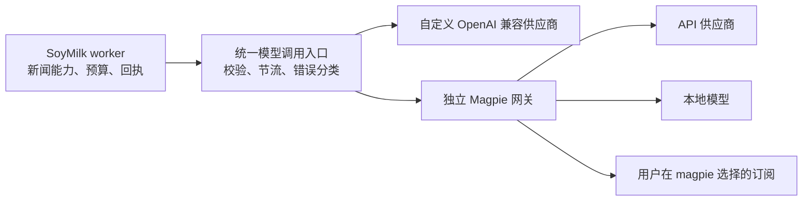

# magpie 接入与内置订阅移除可行性报告（已废弃，仅供参考）

日期：2026-10-23。状态：**方案已废弃，仅保留审查记录供参考**。

使用者于 2026-10-23 因改造复杂度决定不实施本方案。SoyMilk 继续使用现有模型接入，保留内置 ChatGPT／Codex 订阅和自定义供应商功能，不推进 magpie 集成。

下文的技术建议、投入估计、迁移步骤和验收清单均为当时的候选分析，不是当前计划或实施授权。未来如重新考虑，须重新确认需求并核验代码、网络与网关行为。本次仅提交文档记录，没有实施功能改造或生产切换。

## 一、结论与范围

原审查判断：**技术上可行，当时建议采用“SoyMilk 保留自定义供应商，同时把 magpie 作为独立模型网关接入”的方案。** 候选分工为 SoyMilk 继续负责新闻处理、能力分配、质量校验、预算和回执；magpie 负责上游供应商、账号、模型目录及协议适配。

技术上可以复用现有 OpenAI 兼容调用链，不需要把 magpie 的 Go 代码合入 SoyMilk，也不需要先开发 magpie 插件。但目前**不能仅在后台填写 magpie 地址就完成生产接入**：已确认应用的内网访问限制，且现场容器网络探测未连通；还需要处理网关重试与原有付费保护之间的差异。

原审查对候选需求采用以下解释，现已取消实施：

- SoyMilk 最终只提供“自定义 OpenAI 兼容接口”和“Magpie 网关”两类接入体验，移除内置 ChatGPT／Codex 订阅登录及直接调用功能。
- magpie 是否继续使用 ChatGPT 订阅，由用户在 magpie 中选择。移除 SoyMilk 的订阅接入不等于取消订阅，也不要求 magpie 必须使用订阅；完全不用 ChatGPT 时，magpie 只配置所需 API 或本地模型即可。
- 现有自定义供应商、模型能力分配、历史调用与统计保留。换接入方式本身不改变新闻提示词、评分门槛或预算。
- 本轮仅产出报告和同步文档入口；不修改生产设置、连接、账号、网络或队列，不发起真实模型推理。

最终决定：**不进入实施，保留现有方案。** 原审查指出的网络、错误语义及历史任务迁移成本仅作为参考，不形成当前待办，也不预先承诺速度、质量或总 token 改善。

## 二、审查依据与现场事实

### 2.1 代码版本

| 对象 | 本次审查基线 |
| --- | --- |
| SoyMilk | `6a3b6a86c3d0fc7e5f9aa80a14c5392ebd996aa6`，与本轮拉取的 `origin/develop` 一致 |
| magpie | `/home/tromso/projects/magpie`，`e00fbdbbc74f9829027a78769cbeb265d6271fb4` |
| NAS magpie | 现场命令返回 `v0.1.1329`，运行镜像为固定摘要 `sha256:57e403880e2003f31acf74bfb259cc8798f3068ae1ae455e3c4e7cbf420402d4` |

magpie 工作区原有未跟踪的 `work/` 保留；其中部署说明仅用于定位，运行状态另做现场核对。没有证明本地 magpie 提交与 NAS 镜像逐文件一致，因此网关内部行为的源码结论仍须在固定部署版本上复验，不能直接视作线上实测。

### 2.2 当前 SoyMilk 模型配置

北京时间 **2026-10-23 16:59:17**，通过 NAS API 容器的只读查询取得以下脱敏结果：

| 项目 | 现场配置 |
| --- | --- |
| 默认连接 | `type=codex`，模型 `gpt-6-luna`，支持图片，effort 未显式指定 |
| 预筛 | 单独的 Codex 连接，`gpt-6-luna`，`low` |
| 理解、摘要、结构 | 单独的 Codex 连接，`gpt-6-luna`，`medium` |
| 其他已保存连接 | 一条非默认 `api-key` 连接，模型 `gpt-6-luna` |
| 旧环境授权模式 | `LLM_AUTH_MODE` 的有效读取结果为 `api-key`；当前默认连接覆盖这条环境路径 |
| 私网访问开关 | `allowPrivateNetworkFetch=false` |

这确认用户当前主要使用的是网页配置的 Codex／ChatGPT 订阅路径。默认连接的 effort 为“未指定”，**不能把它记成已确认的 medium**。现有 API Key 连接仅确认存在，未验证其可用性，不能预先当作已就绪的备用服务。

本轮未读取账号授权文件或订阅余量；连接配置由容器内函数读取，密钥没有输出，脱敏结果只含类型、型号、effort、图片能力及默认状态。数据库查询使用只读事务，仅查询模型能力配置。

### 2.3 网络验证：两层条件都需要处理

北京时间 **2026-10-23 16:59—17:02**：

| 位置与方法 | 目标 | 结果与含义 |
| --- | --- | --- |
| NAS 宿主机，无凭据 GET | `127.0.0.1:3425/v1/models` | HTTP 401；网关可达且要求鉴权，不代表已验证模型目录 |
| SoyMilk API，实际 `guardedFetch`，无凭据 | `192.168.1.62:3425`、`10.0.7.1:3425` | 均报 `Blocked private address`，调用在应用地址检查处被拒绝 |
| SoyMilk API，独立进程的基础网络探针，无凭据 | 上述两个地址 | 均在 5 秒内未获得响应而超时 |
| SoyMilk worker，同样的基础网络探针，无凭据 | 上述两个地址及 `100.89.232.66:3425` | 三个目标均在 5 秒内未获得响应而超时 |

基础网络探针只用于区分应用拦截与网络连通性，没有修改或绕过正式业务调用策略。所有探针都是无密钥 GET，没有经过 `paidRequest` 或创建付费回执。

现场 magpie 位于 `172.29.12.2`，worker 接口为 `172.29.20.4` 和 `172.29.24.5`；magpie 发布了回环、LAN、Tailscale 和 Linux Station 网桥的网关端口。**这些地址和端口映射不等于 SoyMilk 容器已经可达。** 超时原因尚未定位到具体路由、防火墙或 Docker 转发规则，本轮不据此修改网络。

## 三、可以复用什么

| 能力 | SoyMilk 现状 | magpie 接入判断 |
| --- | --- | --- |
| 模型请求 | 自定义连接向 `${baseUrl}/chat/completions` POST，使用 Bearer Key | magpie 提供相同接口，优先复用此协议 |
| 结果消费 | 读取 `choices[0].message.content`，执行现有解析与 schema 校验 | 不需要改新闻业务层；非流式完整响应及异常响应需做契约测试 |
| JSON 与推理强度 | 已发送 `response_format: json_object`、`reasoning_effort` | magpie 有对应解析与跨协议转换代码；不同上游的实际行为仍需验证 |
| 图片 | 使用 OpenAI 多模态消息结构 | 可复用；须按所选模型目录确认图片能力 |
| 模型目录 | 网页目录主要针对 Codex，自定义接口主要手填型号 | magpie 提供 `GET /v1/models`，需要新增服务端目录读取与前端选择 |
| 业务能力分配 | 预筛、评分、理解、摘要、结构、归组、综述、刊物、翻译独立选择 | 保留，不搬到 magpie |
| 请求保护 | `paidRequest`、预算、回执消费者、unknown 恢复及已付费结果复用 | 必须保留，并补网关错误与重试边界 |
| 供应商统计 | `model_suppliers`、连接归属、请求型号与返回型号 | 可复用，但须区分网关、实际上游与计费类别 |

magpie 自带的 `docs/integrating.md` 明确提供普通应用直接调用网关的接入路线，不要求修改 magpie。本文采用该路线。让 SoyMilk 出现在 magpie 的 Agents 页面需要另做适配，与新闻站接通网关无关，不列入首期。

## 四、原候选结构与后台体验（仅供参考）

### 4.1 分工

SoyMilk 管理业务目的、提示词、模型与 effort 选择、输出质量、调用预算、任务幂等、历史记录。magpie 管理上游账号和 Key、模型目录、协议转换及网关运行情况。

两套配置通过网关 API 连接。SoyMilk 保存专用 Gateway Key，不共享 magpie 的管理密钥、账号配置文件或授权目录。浏览器只访问 SoyMilk 后端，后端才访问 magpie。

### 4.2 后台改造

建议把现有“Codex 账号”区域替换为统一的模型连接管理，新增连接时提供：

| 自定义接口 | Magpie 网关 |
| --- | --- |
| 名称、Base URL、API Key、模型、effort、JSON／图片选项、供应商归属 | 名称、网关 Base URL、专用 Gateway Key、读取模型目录、选择模型与 effort、供应商归属 |

两者继续共享默认连接与能力分配。增加不推理的“检查连接／刷新模型”操作；若以后提供真实推理测试，必须明确其会消耗模型用量，并经过预算和回执。

配置层建议复用 `type=api-key` 的 HTTP 传输，增加明确的网关适配标识，例如 `adapter=magpie`，用于目录、路由元数据和错误分类。字段名为设计建议，实施时确定。不要依靠显示名称或端口号猜测是否为 magpie。

目前一条连接绑定一个模型和 effort；首期可继续创建默认、low、medium 等连接，避免同时重构整个“供应商—多模型”数据结构。

### 4.3 “服务供应商”与网关的关系

SoyMilk 的“服务供应商”现在主要是归属与统计实体，新增一条名为 Magpie 的供应商记录不会自动接通网关。

建议保留三个不同概念：

- **连接归属**：例如自定义供应商或 Magpie，用于说明请求经过哪个入口。
- **实际服务者**：从 magpie 返回的 `X-Magpie-Provider`、`X-Magpie-Model` 记录，不能仅保存 `group/xxx`。
- **计费类别**：由明确配置和可信证据确定，HTTP 使用 API Key 不代表最终一定是 API 现金消耗。

现有回执已可保存响应体中的 `reported_model`；新增工作主要是补网关返回的供应商／完整模型标识，并把“请求型号”和“实际返回型号”区分展示。不要重复创建已有字段，也不要从型号字符串推断账单。

## 五、原方案的技术问题（仅供参考）

### 5.1 内网访问与容器网络

这是现场已确认的接入阻碍。

SoyMilk 的 `guardedFetch` 同时限制私网字面地址和 DNS 解析结果，`route=direct` 也不会自动放行私网；API 与 worker 的生产启动检查还会拒绝 `ALLOW_PRIVATE_NETWORK_FETCH=true`。

建议增加**仅供模型连接使用的可信端点策略**：由部署配置限定目标协议、主机、端口及必要路径；只允许已登记的 magpie 网关，禁止跳转，连接时校验实际目标地址。RSS、正文提取和图片代理继续使用原有保护。地址配置错误应在占用付费回执之前拒绝。

网络层优先评估给 API、worker 与 magpie 增加一条专用 Docker 网络，通过固定服务别名访问网关；只在必要服务之间连通，不把数据库和网页容器一并加入。也可修复经 NAS 已发布端口的路径，但须先确认当前超时原因。无论选哪种，都需要同步网关允许来源与鉴权，并分别验证 API 和 worker。

报告阶段不确定最终 Base URL；上述现场地址只作证据，不作为“照填即用”的配置。

### 5.2 网关重试与付费回执

这是最重要的语义差异。

SoyMilk 的一次 `receipt_attempt` 对应一次应用侧调用；magpie 可能在内部更换账号、模型或重发上游请求。其 `upstream_transport.go` 还将部分 POST 标为 Go 传输层可重放，请求没有携带可证明上游去重的实际幂等凭据。因此：

> SoyMilk 的一次调用次数，不能直接作为 magpie 实际上游尝试次数；已有回执保护不能自动覆盖网关内部的所有重试。

现有 SoyMilk API Key 路径把 HTTP 429／5xx 转为 `ProviderRejectedError`，回执记为 failed。对网关而言，502／504 也可能发生在上游已经接收甚至生成之后，不能一律解释为“未执行、可安全重试”。

建议首期采用以下边界：

1. 使用目录返回的明确 `provider/model`，专用 Gateway Key 限定所需模型与账号；停用此接入范围内的自动换模型、意图路由和其他会改变模型输入的扩展。
2. 多账号时使用单账号权限约束，必要时使用 `X-Magpie-Account`。`stays=strict` 是会话账号粘性，不能证明第一次选路唯一，更不能证明没有重试。
3. 连接前拒绝、明确未执行的鉴权／参数／额度拒绝，与请求已发出后的超时、断流和网关错误分开。后者缺少确定证据时进入 unknown，沿用原有有界恢复。
4. 为每次调用携带稳定且不含新闻正文的关联标识，关联 SoyMilk receipt attempt 与网关记录；`X-Magpie-Session` 可辅助关联，但它本身不是幂等键。
5. 用替身复现“上游已执行但响应丢失”，检查 magpie 实际尝试数及 SoyMilk 状态。仅靠单模型、单账号不能关闭透明重发。

现有连接 `generation` 只感知 SoyMilk 中的配置变化；在 magpie 内更换上游账号或路由，SoyMilk 不会自动得到新的配置身份。首期应固定并审计映射，确需变更时显式更新连接的配置版本，使新工作使用新身份；旧回执、消费者和冻结批次仍保留原身份。不能把一个可随时改变成员的 `group/xxx` 当作永远相同的模型配置。

**本轮没有证实固定版本 magpie 能通过配置关闭所有含歧义的重发，也没有找到可直接依赖的端到端幂等承诺。** 若验收证明其行为无法满足原保护要求，须选择有明确重试控制的网关版本／受控补丁，或让相应工作暂留自定义直连。这是生产准入条件，不把它藏在“兼容 OpenAI”之后。

### 5.3 节流不能随 Codex 代码一起消失

现有并发 1／启动间隔 3000 毫秒位于 `codex-session.ts`，只约束 Codex 请求。把连接改成 API Key 后，即使原环境变量仍在，也不会约束新 HTTP 请求。

建议把这项保护转成网关调用入口的通用队列，首期保持相同限值；同一网关下不同 effort 连接共享约束，不能每条连接各自单路从而叠加突发。等待发生在占用付费回执之前，并响应 worker 排空和关机。

文章分析并发 2、预筛 5 篇／30 分钟、综述合并窗及两次独立评分保持。跨应用共同使用 magpie 的总负载由网关侧治理；SoyMilk 本地节流无法限制其他客户端。

### 5.4 协议兼容不等于输出质量等价

首期继续用 Chat Completions 非流式接口，避免同时重写 Responses／SSE 消费。验证项目包括：

- 完整 JSON、截断输出、空内容和格式错误；保留 SoyMilk schema 校验。
- `low`、`medium` 和“未指定”三种 effort；模型目录不支持时明确提示，不静默调低。
- 图片输入与文本能力；模型目录未知不能直接当作支持。
- 输入、输出、缓存和推理 token；未知字段保持未知，不把推理 token 重复计入总量。
- 现有默认 120 秒请求超时与 magpie 内部排队的关系；客户端取消后网关／上游是否继续执行。

magpie 的格式适配代码可将不支持的结构化输出要求转成提示词约束；即使返回 JSON，也仍需复验价格条件、日期精度、事实归属及误拦边界。更换传输路径可能改变提示词包装与缓存，不预先声称省 token。

### 5.5 统计口径与网关状态

`model-billing.ts` 目前按 `codex/chatgpt` 判为 `subscription_equivalent`，按 API Key 判为 `api`。直接把订阅背后的 magpie 当普通 API 接入，会改变统计分类。

建议把计费类别与传输类型分离，首期按固定连接明确配置；历史订阅等价记录原样展示。动态混合 API／订阅的路由组，在不能准确确定实际上游与价格时应标记未知，不能生成虚假的现金费用。

SoyMilk 保留自己的预算和业务调用数，magpie 记录网关上游尝试与自身限额。双方统计分层展示，失败／重试用量不能因 SoyMilk 只看到一次成功结果而被忽略。是否下降仍按总 token（输入＋输出）判断，不新增现金节省验收门槛。

限权 Gateway Key 不一定能访问所有配额／路由接口；基础接入只依赖模型目录和推理接口，管理页面跳转使用不带密钥的普通入口。配额读取失败不能被误报成推理不可用。

## 六、原候选订阅移除范围（已取消）

代码中存在两条独立路径，均应纳入清理：

| 范围 | 实际入口与改造内容 |
| --- | --- |
| 网页 Codex 订阅 | `model-connections.tsx` 的账号卡、设备授权、轮询、模型目录和断开功能；对应 admin API 与共享类型 |
| Codex 运行时 | `providers/codex.ts`、`codex-session.ts`、worker 启停钩子；先迁移通用节流职责，再移除专用运行时 |
| 旧 ChatGPT 直接授权 | `chatgpt.ts`、`chatgpt-auth.ts`、`scripts/chatgpt-auth.ts`、`LLM_AUTH_MODE=chatgpt` 及相关配置说明 |
| 依赖与运维 | `packages/backend/package.json` 的 `@openai/codex`、锁文件、私有部署覆盖中的专用设置、账号告警和维护脚本 |
| 文档和验证 | 模型配置指南、首次部署、README、AGENTS、API 路由清单、模型管理／回执／网页用例 |

有两个不能机械删除的地方：

- `model-config.ts` 从 `chatgpt-auth.ts` 导入 `atomicPrivateJson`，用于包括 API Key 在内的模型配置持久化；先把通用原子私有文件写入逻辑独立出来。
- 旧 `codex` 类型、订阅计费类别与回执内容仍是历史数据的解释依据；最终可以移除活跃登录与调用代码，同时保留历史读取兼容。

不删除既有 receipts、attempts、consumers、模型统计、审计或旧批次。旧授权文件的撤销／清理与账号是否仍被其他服务使用有关，应在成功切换后的明确维护步骤处理；不自动复制凭据到 magpie，也不在删除功能时顺手擦除数据卷。

## 七、原候选迁移、兼容与回退（已取消）

建议按以下阶段实施，任一阶段未通过时不进入生产切换：

1. **验证网关能力与错误边界。** 确定部署版本、网络方案及可信端点配置；在隔离环境完成目录、协议与失败重放测试，关闭采集和真实模型调用。
2. **完成新接入与通用保护。** 增加 Magpie 连接体验、目录、节流、错误分类和路由元数据；保留原有自定义 API 连接。旧订阅路径只用于迁移过渡。
3. **生成只读迁移预检。** 列出默认连接、各能力引用、冻结批次、pending／unknown 回执和旧连接依赖。当前低／中强度分别映射到新连接，其他能力逐项核对，不仅更换默认项。
4. **受控生产切换。** 在另行授权的发布中排空 worker、备份必要配置、切换连接与能力映射，核对新连接身份，再观察小范围真实工作。真实模型验证属于后续消耗用量的操作，本轮未执行。
5. **移除内置订阅运行时。** 确认未完成工作有安全处置路径后，移除登录、直连、依赖和专用配置，完成正式验收与文档更新。

批次迁移必须区分：

- 未占用回执的批次：现有代码允许在输入或配置变化时取消未发送批次并重排有效成员；沿用既有逻辑，保留原排队时间与审计。
- 已收到响应的批次：直接消费原响应，不能因换网关重新付费；现有 `storedReceipt` 路径可复用。
- 已有回执但结果未知或仍需恢复的批次：保留原请求身份和原状态；不能把新连接 generation 写入旧批次来强行恢复。

`deleteModelConnection` 目前会检查默认项和能力引用，但没有完整覆盖批次的旧连接依赖；因此“后台可以删除连接”不足以证明安全退役。预检和最终 worker 必须保证退役连接上的 unresolved 工作不会自动落入新连接再次请求。需要取消或跳过的历史工作须有明确处置授权。

回退只切换兼容应用和连接设置，保留切换后新增回执与批次，不恢复旧库。旧应用是否能够读取新连接字段、计费类别和新增记录，须在实施阶段验证；过渡期使用加法配置／兼容读取，若新增数据库字段则追加向后兼容迁移。本报告不预先承诺“零迁移”或“任意旧镜像可回退”。

## 八、原方案比较与投入估计（仅供参考）

| 方案 | 主要成本与限制 | 判断 |
| --- | --- | --- |
| 只把 magpie 填成普通自定义 API | 页面变化最少，但现场网络与地址保护阻断；缺目录、错误语义、节流和统计适配，也没移除订阅功能 | 可作为隔离原型，不能作为完整交付 |
| 独立 magpie 网关，加轻量专用适配 | 复用业务处理和 Chat 协议，集中处理上述边界；增加网关运行依赖 | **推荐** |
| 把 magpie 源码或账号管理合入 SoyMilk | 引入 Go／Node 双运行时耦合、账号管理及上游快速变化的维护负担 | 不符合本次精简目的 |
| 全部供应商只留在 magpie | SoyMilk 可更薄，但失去用户明确要求保留的自定义直连接入 | 不采用 |

预期收益是减少 SoyMilk 内部账号授权、令牌续期和专用子进程维护，统一模型接入入口；运维上则增加对 magpie 可用性和升级兼容的依赖。保留自定义连接可以提供人工切换路径，但不自动把失败或 unknown 请求转投另一个供应商。

以下为基于本轮代码审查的单人开发工作量估计，不是交付承诺：

| 阶段 | 估计 |
| --- | --- |
| 网络方案、可信端点与网关错误契约验证 | 1—2 人日 |
| 连接管理、目录、通用节流、回执及统计适配 | 2—3 人日 |
| 订阅移除、迁移预检、隔离回归、发布与回退验证 | 2—3 人日 |
| 合计 | 约 5—8 人日 |

该估计假设 magpie 无需维护额外分支。若必须修改网关重发行为或解决当前 NAS 网络异常，应在首阶段后重新估算。自然日观察时间另计。

## 九、原候选验收标准与实际验证边界

正式实施至少覆盖：

| 验收层 | 通过条件 |
| --- | --- |
| 连接与鉴权 | API、worker 均可到达固定网关；错误 Key 被拒绝；目录正确；浏览器和日志无密钥 |
| 网络边界 | 只有登记的模型端点可访问；任意内网、管理端口、跳转及 DNS 换址不能借此放行 |
| 模型与质量 | 同材料验证 JSON、low／medium、图片、两次评分、预筛、合并分析、综述和刊物；关键事实与条件不退化 |
| 请求保护 | 发送前拒绝、执行后断流、502／504、重启、重放、预算耗尽和冷却状态均有明确结果；验证网关实际尝试数 |
| 历史迁移 | 默认与能力映射完整；未付费／已收到／unknown 批次分别恢复；不重复付款、不删除历史 |
| 统计与节流 | 请求／实际模型可区分；token 未知不补零；网关重试不隐身；并发与启动间隔仍生效 |
| 功能移除 | 页面、API、CLI、worker 及依赖均无活跃内置订阅入口；历史统计仍可读 |
| 工程验证 | 按 AGENTS 执行类型检查、隔离后端套件、网页构建与测试、独立空库 HTTP 验收、站点冒烟和 MCP；新增／删除管理 API 同步路由清单 |

真实质量评测使用冻结材料与原配置建立对照，随后观察完整北京时间日的成功率、unknown、延迟和总 token。隔离替身只能证明程序行为，不能证明真实上游质量或实际节省。

**本轮已完成**：两个仓库的相关源码审查；生产脱敏连接与能力读取；容器和网关版本核对；宿主及容器无凭据网络探测；报告内容、来源路径及差异检查。

**本轮未完成且不宣称通过**：带 Key 的 magpie 模型目录验证、真实推理、网关重试实测、生产容器网络修复、迁移或完整应用回归。生产连接、开关、并发、预算、授权和数据库业务记录均未修改。

## 十、主要源码依据

以下定位对应第二章的固定提交。SoyMilk 链接随本仓库提供；magpie 路径相对于本机 `/home/tromso/projects/magpie`，方便在并排检出仓库中复核。

| 结论 | 依据 |
| --- | --- |
| 三种传输、Chat 参数、状态码与回执 | [llm.ts](../../packages/backend/src/providers/llm.ts)，`chatJsonUnobserved`、`executeChatJson` |
| 连接保存、generation、删除引用检查 | [model-config.ts](../../packages/backend/src/providers/model-config.ts)，`saveModelConnection`、`deleteModelConnection` |
| 供应商是归属实体 | [model-suppliers.ts](../../packages/backend/src/admin/model-suppliers.ts) 与 [共享类型](../../packages/contracts/src/admin.ts) |
| 网页订阅与自定义入口 | [model-connections.tsx](../../apps/web/app/features/admin/model-connections.tsx)、[model-connection-form.ts](../../apps/web/app/features/admin/model-connection-form.ts) |
| 授权 API | [admin routes](../../apps/api/src/routes/admin.ts)，`/api/admin/model-config/codex` 路由族 |
| 私网和生产开关约束 | [http-fetch.ts](../../packages/backend/src/lib/http-fetch.ts)、[url.ts](../../packages/backend/src/lib/url.ts)、[config.ts](../../packages/backend/src/config.ts) |
| 订阅分类与回执结果 | [model-billing.ts](../../packages/backend/src/providers/model-billing.ts)、[receipts.ts](../../packages/backend/src/providers/receipts.ts) |
| 专用节流与 worker 钩子 | [codex-session.ts](../../packages/backend/src/providers/codex-session.ts)、[worker main.ts](../../apps/worker/src/main.ts) |
| 批次恢复与未发送取消 | [jobs/prefilter.ts](../../packages/backend/src/jobs/prefilter.ts)，`processPrefilterBatch`、`cancelUnsent` |
| 通用文件写入的授权模块依赖 | [chatgpt-auth.ts](../../packages/backend/src/providers/chatgpt-auth.ts)，`atomicPrivateJson` |
| 网关集成接口与能力目录 | magpie `docs/integrating.md:17`、`internal/gateway/gateway.go:662` |
| 账号限定、路由与访问权限 | magpie `docs/reference.md:597`、`:1310`、`:1771`；`internal/gateway/gateway.go` 的 `pinTo` 调用 |
| 实际供应商／模型响应头 | magpie `internal/gateway/member.go:3`，`noteMember` |
| 透明重发与结构化输出降级 | magpie `internal/gateway/upstream_transport.go:61`、`internal/gateway/format.go:150` |
| 多候选与内部重试 | magpie `internal/gateway/gateway.go` 的 `cands` 循环、`holdWriter` 和重试计数 |

相关现行说明：[模型配置与账号授权](../运维部署/模型配置与账号授权.md)、[模型配置统计与费用指南](模型配置统计与费用指南.md)、[Codex 限流与新闻请求节流计划](../系统优化/2026-10-21-Codex限流与新闻请求节流计划.md)。这些现行操作文档在实际实现前继续描述当前功能，本文不提前把它们改写为已迁移状态。
