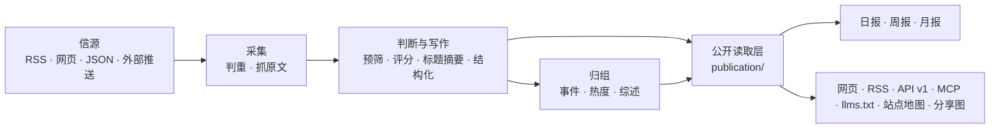

# 架构



## 三个进程

| 进程 | 位置 | 做什么 |
|---|---|---|
| api | `apps/api/` | Fastify。网站自用接口（`/api/site/`）、公开 API（`/api/v1/`）、RSS、MCP、后台接口、图片代理、分享图 |
| worker | `apps/worker/` | pg-boss 任务队列和定时任务：抓信源、调模型、归组、热度、日报、告警、清理 |
| web | `apps/web/` | React Router 服务端渲染的网页。只通过 HTTP 读 api，不碰数据库 |

业务代码都在 `packages/backend/`，前后端共用的类型和常量在 `packages/contracts/`，行业相关的一切在 `industry/`。

## 几条不变的规则

- **一个公开读取层**：网页、RSS、API、MCP、站点地图、分享图读的都是 `packages/backend/src/publication/`。公开范围、发布延迟与事实证据条件只在 `publication/scope.ts` 定义；新增出口也遵循当前的撤回和全文许可。
- **报告文字有输入依赖**：日报记录导语的全部模型输入，周报和月报记录完整编写输入，包括未被直接引用的文章。读取层每次检查这些输入的公开权限；任一失效，就隐藏导语、新闻标题、概述及主题标题和摘要，保留仍可公开的引用。模型结果保存前也在短事务中重核，沿用原回执完成，不重新调用模型。旧报告按保存的候选或阅读顺序保守核对；无法确认依赖的文字回退为固定期名和主题标签。
- **页面不调模型**：读者打开页面只读数据库里已经有的结果；模型只在 worker 的任务里调用。
- **花钱的请求有回执**：每个付费请求（模型、Jina）先记一张回执，拿到结果先存再用。进程重启、任务重试时，复用已经付过钱的结果，不重复花钱（`providers/receipts.ts`）。相同请求可以被多篇文章复用，回执登记每个消费者，但消费者不进入请求身份。结果不明超过 30 分钟后自动放行一次，同一事务恢复所有仍因该回执停住的当前文章版本，继续未完成的正文提取或分析；旧版本和其他原因的失败不恢复。再次结果不明时，由管理员在“运行”页核对后放行。
- **模型定价保留调用时证据**：`providers/model-billing.ts` 确定连接与请求型号归属，`providers/model-pricing.ts` 提供价格快照与估算，`providers/model-usage.ts` 统一用量；快照随付费 attempt 保存。后台费用聚合与明细使用同一分类规则，按 USD／CNY、API／订阅等价金额分别汇总，未知不算零。参考目录仅在手动同步时联网，调价不改账号、请求身份、预算或已有回执。历史补算使用独立运行与结果表，不回写原费用，操作见[模型定价与费用](../功能升级/模型配置统计与费用指南.md)。
- **预算熔断**：每个付费服务有每分钟、每小时、每天的上限，超过就暂停（后台“设置 → 预算”）。
- **等待不消耗失败次数**：正文提取和全文翻译区分结果未知、同一请求在途、预算等待、关闭开关或缺少配置与真实处理失败。等待保留正文待提取状态及原回执身份，不提前转为正文未确认，也不耗尽三次失败上限。放行翻译回执只恢复该版本的翻译，使用单独任务，不重新评分；等待中的旧文章不受三天扫描窗口限制。Jina 正文恢复沿用原抓取轮次，跨日也不能绕开未知回执。
- **安全阀**：`COLLECT_ENABLED`、`MODEL_CALLS_ENABLED` 只决定“发不发出去”，不决定走哪套逻辑。开发和测试时关掉。自动刷新信源图标也受采集开关和信源暂停控制，残留任务在刷新入口及每次页面、图标候选请求前复查；已发送的请求可以完成，但暂停后不写来源结果。
- **公开内容匿名**：管理员和访客看到的一样；读者的收藏、已读存在浏览器里。后台只允许管理员。
- **时间轴可追溯**：实时资料按首次收录时间，事件按新进展首次出现时间排列；回填资料有可信发布时间时按原文时间归档。发现时已超过 48 小时的旧文不当作实时消息；当天发布的回填内容仍可能落在“今天”。模型处理完成不改变时间轴，显示与定时任务使用北京时间，见 [时间轴与时区](../内容管理/时间轴与时区.md)。
- **来源可追溯**：每条精选都链接原文；站内是否显示全文由信源的 `site_fulltext` 决定，默认只显示摘要。
- **规则由所属模块维护**：后台调用内容、事件与恢复模块，不直接改写它们的状态；业务模块不反过来依赖后台。人工修改、公开结果与恢复所需记录一起提交。
- **跨进程接口共享类型**：后台接口以 `packages/contracts/src/admin.ts` 为准，任务载荷以 `jobs/queue.ts` 的 `JobData` 为准，发送方和接收方一起检查。前端仍只通过 HTTP 访问后端。

这些模块边界由 `tests/architecture.test.ts` 检查；检查用的仓库相对路径统一为 `/`，在 Windows 与 Linux 上执行同一套规则，文件读取仍使用系统原生路径。回归夹具同时验证合法归属与真实越层导入、越权写表和重复公开范围条件，不能因路径分隔符不同漏检或误报。调整边界时同时更新约定与检查。后续移植保留 `industry/` 的站点身份、行业分类、提示词和新闻处理边界，不能用某个部署的固定配置替代。

## 目录

| 位置 | 内容 |
|---|---|
| `industry/` | 行业包：站名文案、分类标签、主题、示范信源、提示词、门槛、品牌、条款页 |
| `packages/backend/src/sources/` | 三种主动采集读取器及外部上报，抓取调度（`collect.ts`） |
| `packages/backend/src/content/` | 资料入库、判重、正文提取和清洗 |
| `packages/backend/src/editorial/` | 判断与写作：`analyze.ts`（流程）、`prompts.ts`（读提示词）、`models.ts`（每一步用哪个模型） |
| `packages/backend/src/events/` | 事件归组、热度、事件综述 |
| `packages/backend/src/publication/` | 公开读取层 |
| `packages/backend/src/reports/` | 日报、周报、月报 |
| `packages/backend/src/providers/` | 模型、向量、Jina 的调用，回执与预算 |
| `packages/backend/src/operations/` | 本地诊断、备份、清理 |
| `packages/backend/src/admin/` | 后台接口 |
| `apps/web/app/routes/` | 每个页面一个文件，`routes.ts` 是路由表 |
| `database/migrations/` | 数据库迁移，按编号顺序执行 |
| `scripts/` | 初始化、迁移、种子数据、评测、检查脚本 |
| `tests/` | 后端测试（需要一个名字以 `_test` 或 `_ci` 结尾的空库） |
| `docs/` | 中文分类文档、历史记录与资源，统一入口为[文档索引](../文档索引.md) |

## 对外出口

3.7.0 候选按单人私用范围移除飞书、反馈、联系二维码／作者推广、IndexNow、X／公众号专用采集。下线页面与接口返回 404，旧环境变量不能恢复它们。历史迁移和数据保留，worker 取消旧定时调度及退役队列中尚未执行的任务，保留已完成及在途证据。故障诊断继续持久化到本地状态并写结构化日志，后台“运行”页继续展示；不发送外部消息。详见[精简说明](../系统优化/2026-10-20-单人私用功能精简.md)。

2026-10-13 按使用者要求移除模型榜及 Tibo 重置监控，旧页面、榜单接口、重置监控接口和后台监控入口返回 404。OpenAPI 文档的 `info.version` 随应用版本同步，新闻接口路径仍在 `/api/v1/`；使用旧监控接口的客户端应停止轮询。MCP 的五个新闻只读工具保持原契约。

为兼容既有数据库，历史迁移及榜单、监控表保留，不新建删表迁移；应用不再注册对应采集任务或读取这些专用表。worker 启动时沿用 `registerSchedules()` 的旧调度清理，取消已移除的定时任务。历史回执、投递与审计记录继续保留。

| 地址 | 内容 |
|---|---|
| `/` `/all` `/hot` `/topics` `/daily` `/weekly` `/monthly` | 精选、全部动态、热门事件、主题、日报周报月报 |
| `/feed.xml` `/feed/all.xml` `/feed/full.xml` `/feed/daily.xml` | RSS：精选、全部、全文、日报 |
| `/api/v1/` | 公开 API，文档在 `/openapi-v1.json`，说明页在 `/agent` |
| `/api/mcp` | MCP 服务，工具名前缀是 `industry/site.ts` 的 `mcpPrefix` |
| `/llms.txt` `/sitemap.xml` `/robots.txt` | 给大模型和搜索引擎的说明 |
| `/admin` | 后台 |

## 测试

```bash
npm run typecheck
createdb myhot_test
DATABASE_URL=postgres://127.0.0.1:5432/myhot_test node scripts/migrate.ts
DATABASE_URL=postgres://127.0.0.1:5432/myhot_test npm test
npm run build -w @aihot/web && node --test apps/web/tests/*.test.ts
```

测试不访问任何外部服务：模型和付费接口都由本地假服务回答。
